<!--
  CAM_04 · github.com/mouminkam
  Every image on this page is drawn by brand/generate.mjs: type is outlined from the
  portfolio's own fonts, screenshots are embedded, motion stops under reduced motion.
-->

<a href="https://moumen-alkamsheh.vercel.app">
  
</a>

  
  <a href="https://www.linkedin.com/in/moumen-alkamsheh-386555366/"></a>
  <a href="mailto:mo2min.2001@gmail.com"></a>
  <a href="https://moumen-alkamsheh.vercel.app/Moumen-Alkamsheh-CV.pdf"></a>

I'm **Moumen Alkamsheh**, a full-stack and mobile developer in Damascus. I build Next.js and React front ends,
Node.js and Laravel APIs, and Flutter apps that are live on the App Store and Google Play. I work in English and
Arabic, right-to-left included, and I care about the parts a demo usually skips: the data layer, the tests and
the road to production.


<table>
  <tr>
    <td width="50%" valign="top">
      <a href="https://moumen-alkamsheh.vercel.app/work/promoo"></a>
      
<b>Promoo</b> · FULL-STACK · MOBILE 
      A social marketplace for companies, influencers and service providers: the Flutter app on both stores,
      the Node.js API behind it and the admin dashboard that runs it. 
      <a href="https://apps.apple.com/ae/app/promoo-portal/id6805950429">App Store</a> ·
      <a href="https://play.google.com/store/apps/details?id=com.promoo.app">Google Play</a> ·
      <a href="https://promoo-dashboard-demo.vercel.app">Dashboard demo</a> ·
      <a href="https://github.com/mouminkam/Promoo-dashboard-demo">Code</a> ·
      <a href="https://moumen-alkamsheh.vercel.app/work/promoo">Case study</a>

    </td>
    <td width="50%" valign="top">
      <a href="https://moumen-alkamsheh.vercel.app/work/magic-show"></a>
      
<b>Magic Show</b> · FULL-STACK 
      E-commerce for a handmade footwear brand from Damascus: a Next.js storefront, a React admin console
      with 32 screens, and the Laravel API behind them. 
      <a href="https://magic-show.vercel.app">Store</a> ·
      <a href="https://magic-show-dashboard.vercel.app">Dashboard</a> ·
      <a href="https://github.com/mouminkam/Magic_Show">Store code</a> ·
      <a href="https://github.com/mouminkam/Magic-Show-dashboard">Dashboard code</a> ·
      <a href="https://github.com/mouminkam/Magic-Show-back-end-">API code</a> ·
      <a href="https://moumen-alkamsheh.vercel.app/work/magic-show">Case study</a>

    </td>
  </tr>
  <tr>
    <td width="50%" valign="top">
      <a href="https://moumen-alkamsheh.vercel.app/work/liulong"></a>
      
<b>Liulong</b> · FRONTEND · 3D 
      A re-skinnable showcase for a Cantonese tasting counter. One bamboo steamer, modelled entirely in code,
      travels down the page and turns into each of the five courses. 
      <a href="https://liulong-showcase.vercel.app">Live site</a> ·
      <a href="https://moumen-alkamsheh.vercel.app/work/liulong">Case study</a>

    </td>
    <td width="50%" valign="top">
      <a href="https://moumen-alkamsheh.vercel.app/work/merova"></a>
      
<b>Merova Healthcare</b> · FRONTEND 
      An investor site for a pharmaceutical holding company, built around a scroll-driven hero drawn live on
      canvas. The whole page weighs about 420 KB. 
      <a href="https://merova-project-2.vercel.app">Live site</a> ·
      <a href="https://github.com/mouminkam/MerovaHealthcare">Code</a> ·
      <a href="https://moumen-alkamsheh.vercel.app/work/merova">Case study</a>

    </td>
  </tr>
  <tr>
    <td width="50%" valign="top">
      <a href="https://moumen-alkamsheh.vercel.app/work/shahrayar"></a>
      
<b>Shahrayar</b> · FRONTEND 
      The ordering storefront for a Middle Eastern restaurant: menu, dish customization, cart, coupons and
      checkout, in English, Arabic and Bulgarian. 
      <a href="https://shahrayar.vercel.app">Live site</a> ·
      <a href="https://github.com/mouminkam/Shahrayar">Code</a> ·
      <a href="https://moumen-alkamsheh.vercel.app/work/shahrayar">Case study</a>

    </td>
    <td width="50%" valign="top">
      <a href="https://moumen-alkamsheh.vercel.app/work/maison-eternel"></a>
      
<b>Maison Éternel</b> · FRONTEND 
      A luxury wedding and events platform for the Gulf: venue discovery, a 4-step booking flow, planning
      tools and an operations dashboard. 
      <a href="https://maison-ternel.vercel.app">Live site</a> ·
      <a href="https://github.com/mouminkam/Maison_-ternel">Code</a> ·
      <a href="https://moumen-alkamsheh.vercel.app/work/maison-eternel">Case study</a>

    </td>
  </tr>
</table>

Every public repository follows one standard: the same README anatomy, the same `src/` layout, the same scripts
(`dev`, `build`, `lint`, `typecheck`) and the same CI. Mock data sits behind the same seam a real API would use,
so each front end runs on its own with `npm install && npm run dev`.

| Product | Surface | Repository | Stack |
| --- | --- | --- | --- |
| Magic Show | Storefront | [`Magic_Show`](https://github.com/mouminkam/Magic_Show) | Next.js 16 · TypeScript · Zustand |
| | Admin console | [`Magic-Show-dashboard`](https://github.com/mouminkam/Magic-Show-dashboard) | React 19 · Vite · TanStack |
| | Backend API | [`Magic-Show-back-end-`](https://github.com/mouminkam/Magic-Show-back-end-) | Laravel 12 · Sanctum |
| Promoo | Admin console (public demo) | [`Promoo-dashboard-demo`](https://github.com/mouminkam/Promoo-dashboard-demo) | React 19 · Vite · TanStack |
| Merova Healthcare | Investor site | [`MerovaHealthcare`](https://github.com/mouminkam/MerovaHealthcare) | Next.js 16 · GSAP · Canvas |
| Shahrayar | Ordering storefront | [`Shahrayar`](https://github.com/mouminkam/Shahrayar) | Next.js 16 · Zustand · Stripe |
| Maison Éternel | Events platform | [`Maison_-ternel`](https://github.com/mouminkam/Maison_-ternel) | Next.js 16 · GSAP · Motion |

The Promoo mobile app and its API are private client code; the dashboard is published as a self-contained demo.




| When | Role | Where |
| --- | --- | --- |
| Apr 2026 — now | IT department manager & team leader | Damascus |
| Jan 2025 — Feb 2026 | Front-end engineer | Peak Link |
| Apr — Dec 2025 | Freelance full-stack & mobile developer | Remote |
| Apr — Jul 2025 | Full-stack developer trainee, MERN | Bytes4Future · Aga Khan Foundation |
| Jul — Nov 2023 | Back-end developer intern | Focal X Agency |


Email is the quickest way to reach me: **[mo2min.2001@gmail.com](mailto:mo2min.2001@gmail.com)**.
The [portfolio](https://moumen-alkamsheh.vercel.app) has the full case studies and the [CV](https://moumen-alkamsheh.vercel.app/Moumen-Alkamsheh-CV.pdf);
[LinkedIn](https://www.linkedin.com/in/moumen-alkamsheh-386555366/) has the rest.

<a href="https://moumen-alkamsheh.vercel.app">
  
</a>
